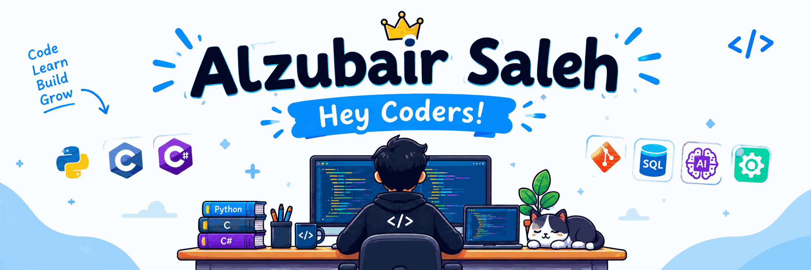

# 👋 Hi, I'm Alzubair Saleh!

  

 

 

### 🚀 Learning, building, and turning ideas into code

---

## 👨‍💻 About Me

Hi! I'm **Alzubair Saleh**, a student and aspiring developer passionate about programming, technology, and continuous learning.

I'm at the beginning of my development journey, building my programming fundamentals and exploring how technology can solve real-world problems.

- 🐍 Learning and practicing **Python**
- 💻 Exploring **C and C#**
- 🤖 Interested in **Artificial Intelligence (AI)**
- ⚙️ Exploring **automation** and smarter workflows
- 🗄️ Learning about **SQL and databases**
- 🔧 Using **Git** to manage and track my code
- 🌱 Always looking for new things to learn and build

> 💡 My goal is to keep learning, create useful projects, and grow into a skilled software developer — one line of code at a time.

## 🛠️ Tech Stack

### Programming Languages

  
  
  

### Tools & Technologies

  
  
  
  

## 🌱 Currently Learning

I'm focusing on strengthening my fundamentals and discovering new areas of software development.

- 🐍 **Python:** Improving my coding skills and problem-solving abilities.
- 💻 **C & C#:** Understanding programming concepts and writing better code.
- 🤖 **AI:** Exploring artificial intelligence and its practical applications.
- ⚙️ **Automation:** Learning how to automate repetitive tasks and workflows.
- 🗄️ **SQL:** Practicing database concepts and data management.
- 🔧 **Git:** Improving my version control and collaboration skills.

## 🚧 Featured Projects

I'm building my skills through practice and personal projects. This section will grow as I publish more of my work!

<!-- Replace these placeholders with your real project links and descriptions. -->

### 🔹 Project One — Coming Soon
A personal project where I can apply what I'm learning and develop my programming skills.

**Technologies:** Python / C / C# — update when the project is ready.

### 🔹 Project Two — Coming Soon
A project exploring automation, problem-solving, or a practical programming idea.

**Technologies:** To be determined.

### 🔹 Project Three — Coming Soon
An opportunity to experiment with AI and discover how intelligent systems work.

**Technologies:** To be determined.

> 💡 Have an idea for a project? Start small, build it, document it, and share it with the world!

## 📫 Connect With Me

I'm happy to connect with fellow students, developers, and anyone interested in technology and learning.

---

### ⚡ A Little Reminder

**Every expert was once a beginner. Keep coding, keep learning, and never stop exploring!**

*Thanks for visiting my profile! ⭐*

## 📊 My GitHub Statistics

▶️ More stats

 

---

### ⚡ Code Cycle

&nbsp;&nbsp;&nbsp;

&nbsp;&nbsp;&nbsp;

*Write code → Debug → Make it work → Repeat 🔁*

